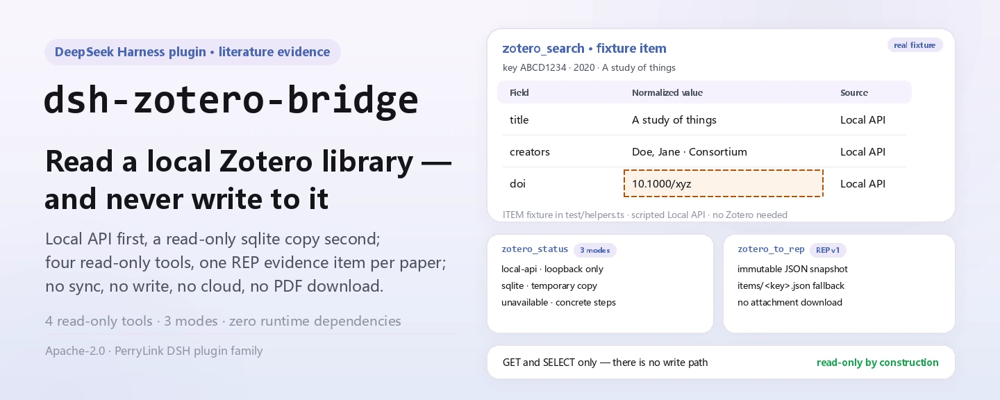
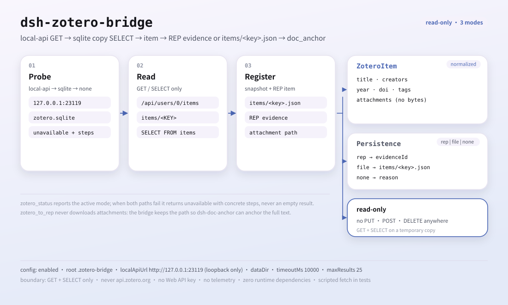

<div align="center">

<picture>
  <source media="(prefers-color-scheme: dark)" srcset="docs/assets/dsh-zotero-bridge-hero-en-dark.webp">
  
</picture>

# dsh-zotero-bridge

**Lee una biblioteca local de Zotero — y registra el elemento como evidencia. Sin escribir nunca en ella.**

*Local API primero, una copia temporal de `zotero.sqlite` después, y un elemento de evidencia REP por cada trabajo seleccionado. Sin sincronización, sin escritura, sin nube, sin descarga de PDF.*

Compatibilidad de host: DeepSeek Harness `dsh-v0.2.2-rc.4` (verificado el 2026-11-18).

[English](README.md) · [简体中文](README-zh.md) · [Español](README-es.md) · [Português](README-pt.md) · [हिन्दी](README-hi.md)

[](LICENSE)
[]()
[](https://github.com/topics/dsh-plugin)

</div>

---

## Por qué solo lectura

Tu biblioteca de Zotero es la única copia de años de trabajo. Una escritura errónea puede corromper `zotero.sqlite` o desincronizar el cliente de escritorio. Por eso este plugin **no tiene ninguna ruta de escritura**: solo hace `GET` contra la Local API y `SELECT` contra una copia temporal de la base de datos.


<picture>
  <source media="(prefers-color-scheme: dark)" srcset="docs/assets/dsh-zotero-bridge-flow-v5-dark.svg">
  .json sin descargar adjuntos; las etiquetas del diagrama son los nombres reales de herramientas, endpoints y campos">
</picture>

*Estructura: sondear → leer → registrar; un `ZoteroItem` normalizado y su persistencia (`rep` / `file` / `none`) son las dos salidas, y no hay una tercera ruta por la que se escriba la biblioteca. Las etiquetas de token dentro del diagrama son los nombres reales de herramientas, endpoints y campos, así que la misma imagen sirve para los cinco idiomas.*

## Modos

| Modo | Cuándo | Qué ocurre |
|---|---|---|
| `local-api` | Zotero está en ejecución con **Ajustes → Avanzado → «Permitir que otras aplicaciones de este equipo se comuniquen con Zotero»** | Lee `http://127.0.0.1:23119/api/users/0/...` (solo loopback) |
| `sqlite` | La Local API no responde y existe `zotero.sqlite` | Copia la base de datos a un directorio temporal, abre la copia en solo lectura, extrae los elementos y borra la copia |
| `unavailable` | Ninguno de los dos | Devuelve pasos concretos en lugar de un resultado vacío |

## Herramientas

| Herramienta | Función |
|---|---|
| `zotero_status` | Sondea la API, localiza la base de datos e informa del modo activo y de la política de solo lectura |
| `zotero_search` | Consulta la biblioteca; devuelve título, autores, año, DOI, resumen, etiquetas, colecciones y metadatos de adjuntos |
| `zotero_item` | Lee un elemento por key, incluidas sus entradas hijas de adjunto |
| `zotero_to_rep` | Captura el elemento como una instantánea JSON inmutable + evidencia REP (o `<root>/items/<key>.json`) |

`zotero_to_rep` **no** descarga PDF. Cuando necesites anclas a nivel de página, ejecuta `doc_anchor` sobre la ruta del adjunto — el puente conserva la ruta en los metadatos para que ambos plugins se encuentren.

## Instalación

```sh
dsh plugin --profile <name> add dsh-zotero-bridge
dsh --profile <name> --dump-config | grep dsh-zotero-bridge
```

Luego:

```text
Run zotero_status.
```

Si informa `unavailable`, inicia Zotero y activa la Local API, o configura `dataDir` con el directorio que contiene `zotero.sqlite`.

## Configuración

| Clave | Por defecto | Significado |
|---|---|---|
| `enabled` | `true` | `false` no monta nada |
| `root` | `.zotero-bridge` | raíz de reserva para los registros de elementos |
| `localApiUrl` | `http://127.0.0.1:23119` | solo loopback; cualquier otro host falla la validación |
| `dataDir` | detección automática | directorio de datos de Zotero (o el archivo `zotero.sqlite`) |
| `timeoutMs` | `10000` | plazo por petición |
| `maxResults` | `25` | tope de búsqueda (1–100) |

## Lo que no hace

- **Sin escrituras.** No crea, actualiza ni borra; sin notas, etiquetas, colecciones ni papelera.
- **Sin sincronización.** Nunca habla con `api.zotero.org`.
- **Sin descarga ni análisis de PDF.** Solo metadatos de adjuntos; usa `dsh-doc-anchor` para el texto.
- **Sin claves de la Web API.** La Local API no necesita cuenta ni clave.
- **Sin degradación silenciosa.** Si ambos modos fallan, la herramienta informa `unavailable` con pasos.

## Compatibilidad

| | |
|---|---|
| Zotero | 7+ (Local API con opt-in); el fallback sqlite lee el esquema de Zotero 6/7 |
| Node | `^22.19.0 \|\| >=24.9.0` (sqlite usa `node:sqlite`) |
| DeepSeek Harness | línea peer `dsh-v0.2.2-rc.4` (2026-11-18); `>=0.2.1-0 <0.3.0 \|\| >=0.2.2-0 <0.3.0` |
| Peers | `@perrylink/dsh-research-core ^0.1.0`, `@deepseek-ai/cordis`, `@deepseek-ai/dsh-tools`, `@deepseek-ai/schemastery` |
| Dependencias en tiempo de ejecución | **cero** |

## Desarrollo


*Animado: la salida real de `pnpm run check:lockfile`, `pnpm test` y `pnpm verify:package` el 2026-11-21 (5 archivos de test, 16 tests, fetch scriptado + una copia temporal de sqlite — sin Zotero, sin red). El plugin no tiene CLI, así que sus puertas documentadas son la ejecución: el lockfile mantiene su forma de dos documentos, se ejercitan las cuatro herramientas y el fallback sqlite, y la superficie del paquete se verifica en solo lectura.*


```sh
pnpm install
pnpm run check:lockfile
pnpm typecheck
pnpm test          # fixture DB + mock Local API; no se necesita Zotero
pnpm build
pnpm verify:package
```

El lockfile se commitea exactamente como lo escribe `pnpm install --lockfile-only` (dos documentos: el documento del gestor de paquetes de pnpm y después el del proyecto), así que una instalación local no lo reescribe. `pnpm run check:lockfile` falla cuando el lockfile se desvía de `package.json` o pierde esa forma.

El test de sqlite crea una base de datos mínima con forma de Zotero en un directorio temporal; el test de la Local API usa un fetch scriptado. La aceptación contra una biblioteca real es manual: ejecuta `zotero_status` en una máquina con Zotero.

## Licencia

Apache-2.0. Véase [LICENSE](LICENSE).
