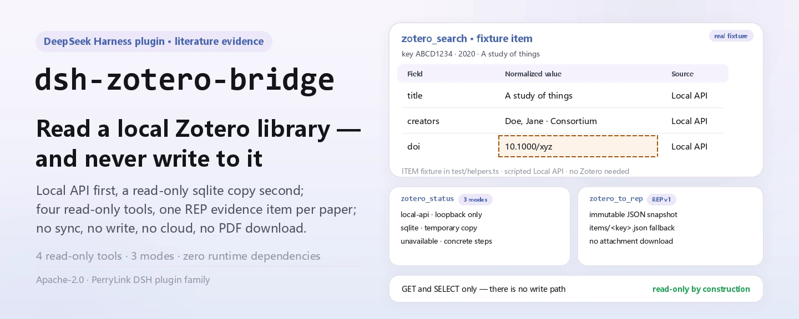
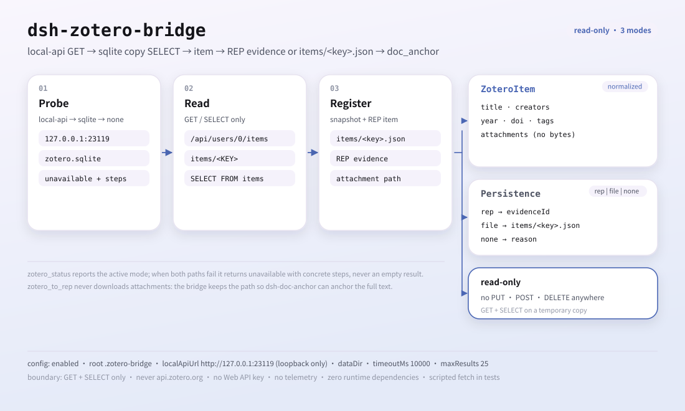
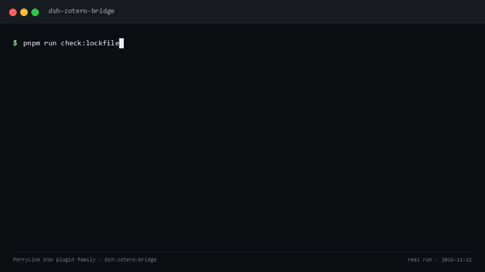

<div align="center">

<picture>
  <source media="(prefers-color-scheme: dark)" srcset="docs/assets/dsh-zotero-bridge-hero-en-dark.webp">
  
</picture>

# dsh-zotero-bridge

**अपनी स्थानीय Zotero लाइब्रेरी पढ़ें — और आइटम को एविडेंस के रूप में दर्ज करें। उसमें कभी न लिखें।**

*पहले Local API, फिर `zotero.sqlite` की अस्थायी प्रति, और हर चुने गए पेपर के लिए एक REP एविडेंस आइटम। कोई सिंक नहीं, कोई राइट नहीं, कोई क्लाउड नहीं, कोई PDF डाउनलोड नहीं।*

होस्ट अनुकूलता: DeepSeek Harness `dsh-v0.2.2-rc.4` (2026-11-18 को सत्यापित)।

अंतिम सत्यापन: DeepSeek Harness `dsh-v0.2.3-alpha.1` (2026-11-22).

[English](README.md) · [简体中文](README-zh.md) · [Español](README-es.md) · [Português](README-pt.md) · [हिन्दी](README-hi.md)

[](LICENSE)
[]()
[](https://github.com/topics/dsh-plugin)

</div>

---

## यह केवल-पठन क्यों है

आपकी Zotero लाइब्रेरी सालों के काम की एकमात्र प्रति है। एक ग़लत राइट `zotero.sqlite` को ख़राब कर सकता है या डेस्कटॉप क्लाइंट को बेमेल कर सकता है। इसलिए इस प्लगइन में **लिखने का कोई रास्ता नहीं है**: यह केवल Local API पर `GET` और डेटाबेस की एक अस्थायी प्रति पर `SELECT` करता है।

<picture>
  <source media="(prefers-color-scheme: dark)" srcset="docs/assets/dsh-zotero-bridge-flow-v5-dark.svg">
  .json दर्ज करता है; आरेख के लेबल असली टूल, एंडपॉइंट और फ़ील्ड नाम हैं">
</picture>

*संरचना: जाँच → पढ़ना → दर्ज करना; सामान्यीकृत `ZoteroItem` और उसकी स्थायीता (`rep` / `file` / `none`) दो आउटपुट हैं, और कोई तीसरा रास्ता नहीं है जिससे लाइब्रेरी में लिखा जाए। आरेख के अंदर के टोकन लेबल असली टूल, एंडपॉइंट और फ़ील्ड नाम हैं, इसलिए एक ही चित्र पाँचों भाषाओं के लिए काम करता है।*

## मोड

| मोड | कब | क्या होता है |
|---|---|---|
| `local-api` | Zotero चल रहा है और **सेटिंग्स → एडवांस्ड → “इस कंप्यूटर के अन्य एप्लिकेशन को Zotero से संवाद करने दें”** चालू है | `http://127.0.0.1:23119/api/users/0/...` पढ़ता है (केवल लूपबैक) |
| `sqlite` | Local API उपलब्ध नहीं है और `zotero.sqlite` मौजूद है | डेटाबेस को अस्थायी डायरेक्टरी में कॉपी करता है, कॉपी को केवल-पठन खोलता है, आइटम निकालता है और कॉपी हटा देता है |
| `unavailable` | दोनों में से कोई नहीं | खाली परिणाम के बजाय ठोस कदम लौटाता है |

## टूल

| टूल | काम |
|---|---|
| `zotero_status` | API जाँचता है, डेटाबेस ढूँढता है, सक्रिय मोड और केवल-पठन नीति बताता है |
| `zotero_search` | लाइब्रेरी में खोजता है; शीर्षक, लेखक, वर्ष, DOI, सारांश, टैग, संग्रह और अटैचमेंट मेटाडेटा लौटाता है |
| `zotero_item` | key से एक आइटम पढ़ता है, उसके अटैचमेंट चाइल्ड सहित |
| `zotero_to_rep` | आइटम को अपरिवर्तनीय JSON स्नैपशॉट + REP एविडेंस के रूप में कैप्चर करता है (या `<root>/items/<key>.json`) |

`zotero_to_rep` PDF **नहीं** डाउनलोड करता। जब आपको पेज-स्तरीय एंकर चाहिए, तो अटैचमेंट पथ पर `doc_anchor` चलाएँ — ब्रिज पथ को मेटाडेटा में रखता है ताकि दोनों प्लगइन मिल सकें।

## इंस्टॉल

```sh
dsh plugin --profile <name> add dsh-zotero-bridge
dsh --profile <name> --dump-config | grep dsh-zotero-bridge
```

फिर:

```text
Run zotero_status.
```

अगर यह `unavailable` बताए, तो Zotero शुरू करें और Local API चालू करें, या `dataDir` को उस डायरेक्टरी पर सेट करें जिसमें `zotero.sqlite` है।

## कॉन्फ़िगरेशन

| कुंजी | डिफ़ॉल्ट | अर्थ |
|---|---|---|
| `enabled` | `true` | `false` कुछ भी माउंट नहीं करता |
| `root` | `.zotero-bridge` | आइटम रिकॉर्ड के लिए फ़ॉलबैक रूट |
| `localApiUrl` | `http://127.0.0.1:23119` | केवल लूपबैक; कोई अन्य होस्ट वैलिडेशन में विफल होता है |
| `dataDir` | स्वतः पहचान | Zotero डेटा डायरेक्टरी (या `zotero.sqlite` फ़ाइल) |
| `timeoutMs` | `10000` | प्रति-अनुरोध समय-सीमा |
| `maxResults` | `25` | खोज की सीमा (1–100) |

## यह क्या नहीं करता

- **कोई राइट नहीं।** न बनाना/बदलना/हटाना, न नोट्स, न टैग, न संग्रह, न ट्रैश।
- **कोई सिंक नहीं।** यह कभी `api.zotero.org` से बात नहीं करता।
- **PDF डाउनलोड या पार्सिंग नहीं।** केवल अटैचमेंट मेटाडेटा; टेक्स्ट के लिए `dsh-doc-anchor` इस्तेमाल करें।
- **Web API कुंजियाँ नहीं।** Local API को खाता या कुंजी नहीं चाहिए।
- **चुपचाप फ़ॉलबैक नहीं।** अगर दोनों मोड विफल हों, तो टूल कदमों के साथ `unavailable` बताता है।

## अनुकूलता

| | |
|---|---|
| Zotero | 7+ (Local API ऑप्ट-इन); sqlite फ़ॉलबैक Zotero 6/7 स्कीमा पढ़ता है |
| Node | `^22.19.0 \|\| >=24.9.0` (sqlite `node:sqlite` इस्तेमाल करता है) |
| DeepSeek Harness | peer लाइन `dsh-v0.2.2-rc.4` (2026-11-18); `>=0.2.1-0 <0.3.0 \|\| >=0.2.2-0 <0.3.0` |
| Peers | `@perrylink/dsh-research-core ^0.1.0`, `@deepseek-ai/cordis`, `@deepseek-ai/dsh-tools`, `@deepseek-ai/schemastery` |
| रनटाइम निर्भरताएँ | **शून्य** |

## डेवलपमेंट



*एनिमेटेड: 2026-11-21 को `pnpm run check:lockfile`, `pnpm test` और `pnpm verify:package` का असली आउटपुट (5 टेस्ट फ़ाइलें, 16 टेस्ट, स्क्रिप्टेड fetch + sqlite की अस्थायी प्रति — Zotero की ज़रूरत नहीं, नेटवर्क नहीं)। प्लगइन में CLI नहीं है, इसलिए उसके दस्तावेज़ी गेट ही वह रन हैं: lockfile अपना दो-दस्तावेज़ रूप बनाए रखता है, चारों टूल और sqlite फ़ॉलबैक अभ्यास में आते हैं, और पैकेज सतह केवल-पठन सत्यापित होती है।*

```sh
pnpm install
pnpm run check:lockfile
pnpm typecheck
pnpm test          # fixture DB + mock Local API; no Zotero required
pnpm build
pnpm verify:package
```

lockfile ठीक वैसे ही कमिट होता है जैसे `pnpm install --lockfile-only` उसे लिखता है (दो दस्तावेज़: पहले pnpm का अपना पैकेज-मैनेजर दस्तावेज़, फिर प्रोजेक्ट का), इसलिए स्थानीय इंस्टॉल उसे फिर से नहीं लिखता। `pnpm run check:lockfile` तब विफल होता है जब lockfile `package.json` से भटक जाए या वह रूप खो दे।

sqlite टेस्ट अस्थायी डायरेक्टरी में Zotero-आकार का एक न्यूनतम डेटाबेस बनाता है; Local API टेस्ट स्क्रिप्टेड fetch इस्तेमाल करता है। असली लाइब्रेरी के साथ स्वीकृति मैन्युअल है: Zotero वाली मशीन पर `zotero_status` चलाएँ।

## लाइसेंस

Apache-2.0। देखें [LICENSE](LICENSE)।
