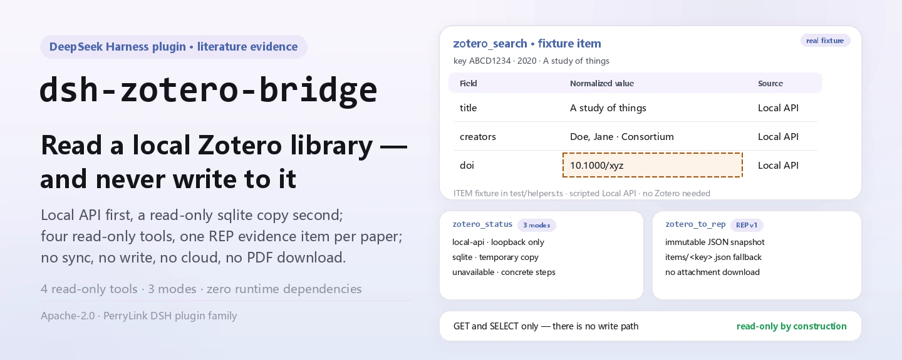
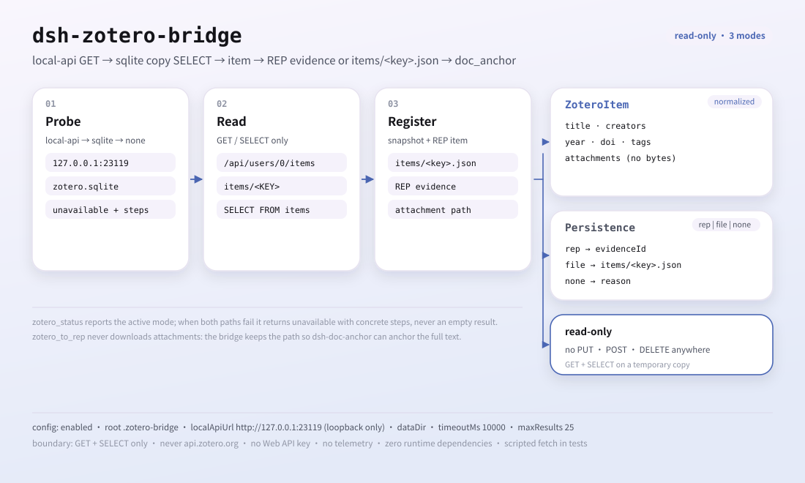

<div align="center">

<picture>
  <source media="(prefers-color-scheme: dark)" srcset="docs/assets/dsh-zotero-bridge-hero-en-dark.webp">
  
</picture>

# dsh-zotero-bridge

**Leia uma biblioteca local do Zotero — e registre o item como evidência. Nunca escreva nela.**

*Local API primeiro, uma cópia temporária do `zotero.sqlite` depois, e um item de evidência REP por trabalho selecionado. Sem sincronização, sem escrita, sem nuvem, sem download de PDF.*

Compatibilidade de host: DeepSeek Harness `dsh-v0.2.2-rc.4` (verificado em 2026-11-18).

Última verificação: DeepSeek Harness `dsh-v0.2.3-alpha.1` (2026-11-22).

[English](README.md) · [简体中文](README-zh.md) · [Español](README-es.md) · [Português](README-pt.md) · [हिन्दी](README-hi.md)

[](LICENSE)
[]()
[](https://github.com/topics/dsh-plugin)

</div>

---

## Por que somente leitura

Sua biblioteca do Zotero é a única cópia de anos de trabalho. Uma única escrita errada pode corromper o `zotero.sqlite` ou dessincronizar o cliente de desktop. Por isso este plugin **não tem nenhum caminho de escrita**: ele só faz `GET` na Local API e `SELECT` em uma cópia temporária do banco de dados.

<picture>
  <source media="(prefers-color-scheme: dark)" srcset="docs/assets/dsh-zotero-bridge-flow-v5-dark.svg">
  .json sem baixar anexos; os rótulos do diagrama são os nomes reais de ferramentas, endpoints e campos">
</picture>

*Estrutura: sondar → ler → registrar; um `ZoteroItem` normalizado e sua persistência (`rep` / `file` / `none`) são as duas saídas, e não existe um terceiro caminho pelo qual a biblioteca seja escrita. Os rótulos de token dentro do diagrama são os nomes reais de ferramentas, endpoints e campos, então a mesma imagem serve para os cinco idiomas.*

## Modos

| Modo | Quando | O que acontece |
|---|---|---|
| `local-api` | O Zotero está rodando com **Configurações → Avançado → “Permitir que outros aplicativos neste computador se comuniquem com o Zotero”** | Lê `http://127.0.0.1:23119/api/users/0/...` (somente loopback) |
| `sqlite` | A Local API está fora do ar e existe `zotero.sqlite` | Copia o banco de dados para um diretório temporário, abre a cópia em somente leitura, extrai os itens e apaga a cópia |
| `unavailable` | Nenhum dos dois | Devolve passos concretos em vez de um resultado vazio |

## Ferramentas

| Ferramenta | Função |
|---|---|
| `zotero_status` | Sonda a API, localiza o banco de dados e informa o modo ativo e a política de somente leitura |
| `zotero_search` | Consulta a biblioteca; devolve título, autores, ano, DOI, resumo, tags, coleções e metadados de anexos |
| `zotero_item` | Lê um item por key, incluindo seus itens filhos de anexo |
| `zotero_to_rep` | Captura o item como um snapshot JSON imutável + evidência REP (ou `<root>/items/<key>.json`) |

`zotero_to_rep` **não** baixa PDFs. Quando você precisar de âncoras em nível de página, execute `doc_anchor` sobre o caminho do anexo — a ponte mantém o caminho nos metadados para que os dois plugins se encontrem.

## Instalação

```sh
dsh plugin --profile <name> add dsh-zotero-bridge
dsh --profile <name> --dump-config | grep dsh-zotero-bridge
```

Depois:

```text
Run zotero_status.
```

Se ele informar `unavailable`, inicie o Zotero e ative a Local API, ou defina `dataDir` com o diretório que contém `zotero.sqlite`.

## Configuração

| Chave | Padrão | Significado |
|---|---|---|
| `enabled` | `true` | `false` não monta nada |
| `root` | `.zotero-bridge` | raiz de fallback para os registros de itens |
| `localApiUrl` | `http://127.0.0.1:23119` | somente loopback; qualquer outro host falha na validação |
| `dataDir` | detecção automática | diretório de dados do Zotero (ou o arquivo `zotero.sqlite`) |
| `timeoutMs` | `10000` | prazo por requisição |
| `maxResults` | `25` | limite de busca (1–100) |

## O que ele não faz

- **Sem escritas.** Nada de criar/atualizar/excluir, sem notas, tags, coleções ou lixeira.
- **Sem sincronização.** Nunca fala com `api.zotero.org`.
- **Sem download ou parsing de PDF.** Apenas metadados de anexos; use `dsh-doc-anchor` para o texto.
- **Sem chaves da Web API.** A Local API não precisa de conta nem de chave.
- **Sem fallback silencioso.** Se os dois modos falharem, a ferramenta informa `unavailable` com passos.

## Compatibilidade

| | |
|---|---|
| Zotero | 7+ (Local API com opt-in); o fallback sqlite lê o esquema do Zotero 6/7 |
| Node | `^22.19.0 \|\| >=24.9.0` (sqlite usa `node:sqlite`) |
| DeepSeek Harness | linha peer `dsh-v0.2.2-rc.4` (2026-11-18); `>=0.2.1-0 <0.3.0 \|\| >=0.2.2-0 <0.3.0` |
| Peers | `@perrylink/dsh-research-core ^0.1.0`, `@deepseek-ai/cordis`, `@deepseek-ai/dsh-tools`, `@deepseek-ai/schemastery` |
| Dependências em tempo de execução | **zero** |

## Desenvolvimento


*Animado: a saída real de `pnpm run check:lockfile`, `pnpm test` e `pnpm verify:package` em 2026-11-21 (5 arquivos de teste, 16 testes, fetch scriptado + uma cópia temporária do sqlite — sem Zotero, sem rede). O plugin não tem CLI, então suas portas documentadas são a execução: o lockfile mantém sua forma de dois documentos, as quatro ferramentas e o fallback sqlite são exercitados, e a superfície do pacote é verificada em somente leitura.*

```sh
pnpm install
pnpm run check:lockfile
pnpm typecheck
pnpm test          # fixture DB + mock Local API; no Zotero required
pnpm build
pnpm verify:package
```

O lockfile é commitado exatamente como `pnpm install --lockfile-only` o escreve (dois documentos: o documento do gerenciador de pacotes do pnpm e depois o do projeto), então uma instalação local não o reescreve. `pnpm run check:lockfile` falha quando o lockfile diverge do `package.json` ou perde essa forma.

O teste de sqlite cria um banco de dados mínimo com a forma do Zotero em um diretório temporário; o teste da Local API usa um fetch scriptado. A aceitação contra uma biblioteca real é manual: execute `zotero_status` em uma máquina com Zotero.

## Licença

Apache-2.0. Veja [LICENSE](LICENSE).
