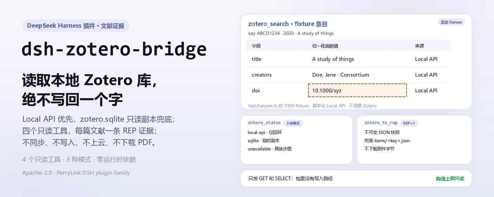
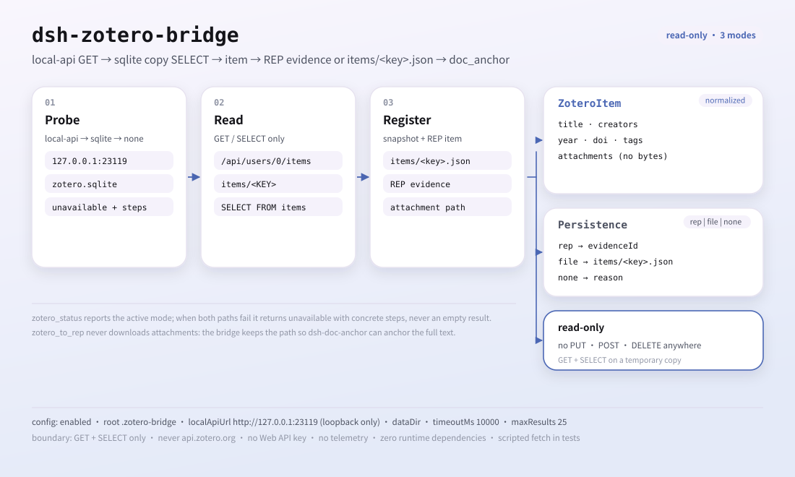
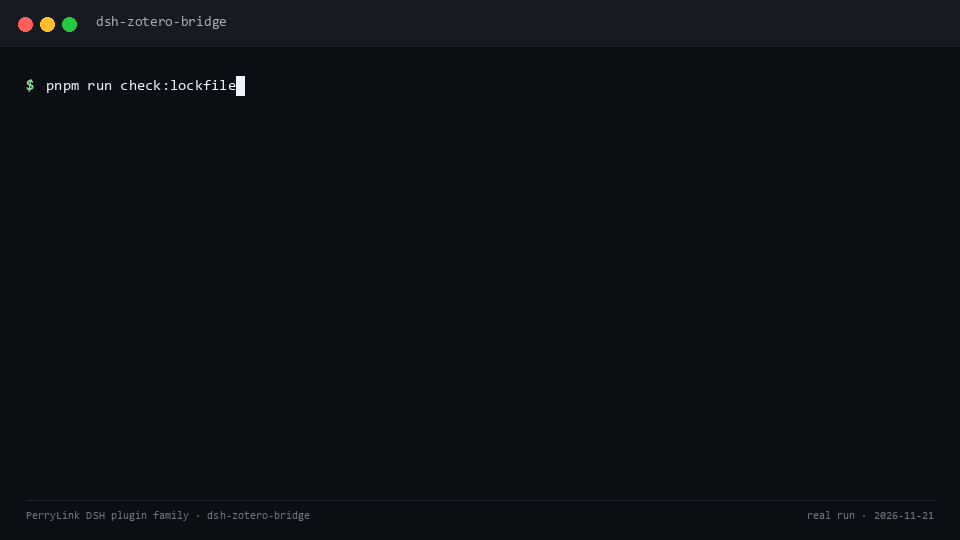

<div align="center">

<picture>
  <source media="(prefers-color-scheme: dark)" srcset="docs/assets/dsh-zotero-bridge-hero-zh-dark.webp">
  
</picture>

# dsh-zotero-bridge

**读取本地 Zotero 文献库，并把条目登记为证据 —— 但绝不写回。**

*Local API 优先，`zotero.sqlite` 临时副本兜底，每篇选中的文献生成一条 REP 证据。不同步、不写入、不上云、不下载 PDF。*

宿主兼容性：DeepSeek Harness `dsh-v0.2.2-rc.4`（2026-11-18 核验）。

最近一次核验：DeepSeek Harness `dsh-v0.2.3-alpha.1`（2026-11-22）。

[English](README.md) · [Español](README-es.md) · [Português](README-pt.md) · [हिन्दी](README-hi.md)

[](LICENSE)
[]()
[](https://github.com/topics/dsh-plugin)

</div>

---

## 为什么只读

你的 Zotero 库是多年工作的唯一副本。一次错误的写入就可能损坏 `zotero.sqlite`，或让桌面端状态错乱。因此这个插件**没有任何写入路径**：只对 Local API 发 `GET`，只对数据库**副本**做 `SELECT`。

<picture>
  <source media="(prefers-color-scheme: dark)" srcset="docs/assets/dsh-zotero-bridge-flow-v5-dark.svg">
  .json，不下载附件；图内标签就是真实的工具名、端点与字段名">
</picture>

*结构：探测 → 读取 → 登记；归一化的 `ZoteroItem` 与它的落地方式（`rep` / `file` / `none`）是两条输出，不存在第三条把库写坏的路径。图内只有工具名、端点与字段名，五语共用同一张结构图。*

## 三种模式

| 模式 | 条件 | 行为 |
|---|---|---|
| `local-api` | Zotero 正在运行，且开启了**设置 → 高级 →「允许此计算机上的其他应用程序与 Zotero 通信」** | 读 `http://127.0.0.1:23119/api/users/0/...`（仅回环） |
| `sqlite` | Local API 不可达，但存在 `zotero.sqlite` | 把数据库复制到临时目录，以只读方式打开副本、抽取条目，然后删除副本 |
| `unavailable` | 两者都没有 | 返回具体修复步骤，而不是空结果 |

## 工具

| 工具 | 作用 |
|---|---|
| `zotero_status` | 探测 API、查找数据库，报告当前模式与只读策略 |
| `zotero_search` | 检索文献库；返回标题、作者、年份、DOI、摘要、标签、收藏夹、附件元数据 |
| `zotero_item` | 按 key 读取单条，含附件子项 |
| `zotero_to_rep` | 把条目存成不可变 JSON 快照 + REP 证据（或 `<root>/items/<key>.json`） |

`zotero_to_rep` **不下载 PDF**。需要页码级锚点时，对附件路径运行 `doc_anchor` —— 桥接插件会把路径保留在元数据里，两个插件可以对接。

## 安装

```sh
dsh plugin --profile <name> add dsh-zotero-bridge
dsh --profile <name> --dump-config | grep dsh-zotero-bridge
```

然后：

```text
Run zotero_status.
```

若报告 `unavailable`：启动 Zotero 并开启 Local API，或把 `dataDir` 指向存放 `zotero.sqlite` 的目录。

## 配置

| 键 | 默认 | 含义 |
|---|---|---|
| `enabled` | `true` | `false` 不挂载任何工具 |
| `root` | `.zotero-bridge` | 条目记录兜底根目录 |
| `localApiUrl` | `http://127.0.0.1:23119` | 仅回环；其它 host 直接校验失败 |
| `dataDir` | 自动探测 | Zotero 数据目录（或 `zotero.sqlite` 文件） |
| `timeoutMs` | `10000` | 单请求超时 |
| `maxResults` | `25` | 检索上限（1–100） |

## 它不做什么

- **不写入。** 不建/改/删条目，不写笔记、标签、收藏夹，不动回收站。
- **不同步。** 从不访问 `api.zotero.org`。
- **不下载/解析 PDF。** 只有附件元数据；全文交给 `dsh-doc-anchor`。
- **不需要 Web API key。** Local API 不需要账号或密钥。
- **不静默降级。** 两种模式都失败时返回 `unavailable` 和修复步骤。

## 兼容性

| | |
|---|---|
| Zotero | 7+（Local API 需手动开启）；sqlite 兜底读 Zotero 6/7 schema |
| Node | `^22.19.0 \|\| >=24.9.0`（sqlite 用 `node:sqlite`） |
| DeepSeek Harness | peer 区间 `dsh-v0.2.2-rc.4`（2026-11-18）；`>=0.2.1-0 <0.3.0 \|\| >=0.2.2-0 <0.3.0` |
| Peers | `@perrylink/dsh-research-core ^0.1.0`、`@deepseek-ai/cordis`、`@deepseek-ai/dsh-tools`、`@deepseek-ai/schemastery` |
| 运行时依赖 | **零** |

## 开发



*动图是 2026-11-21 真实运行的 `pnpm run check:lockfile`、`pnpm test`、`pnpm verify:package` 输出（5 个测试文件、16 个测试，脚本化 fetch + sqlite 临时副本 —— 不需要 Zotero，不联网）。插件没有 CLI，它文档里写的门禁就是那次运行：锁文件保持两段形式、四个工具与 sqlite 兜底都被覆盖、发布包的对外表面被验成只读。*

```sh
pnpm install
pnpm run check:lockfile
pnpm typecheck
pnpm test          # fixture DB + mock Local API，不需要 Zotero
pnpm build
pnpm verify:package
```

锁文件按 `pnpm install --lockfile-only` 的原样提交（两段：pnpm 自身的管理文档 + 项目文档），本地 `pnpm install` 不会改写它；`pnpm run check:lockfile` 在它与 `package.json` 不一致或丢失该形式时失败。

sqlite 测试会在临时目录建一个最小 Zotero schema 数据库；Local API 测试用 scripted fetch。真实库验收是手动的：在有 Zotero 的机器上跑 `zotero_status`。

## 许可

Apache-2.0，见 [LICENSE](LICENSE)。
