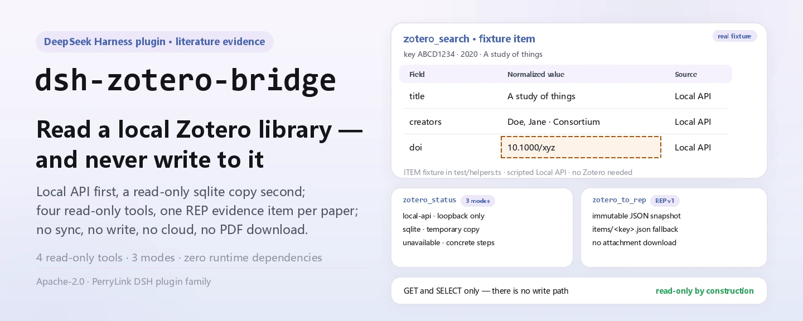
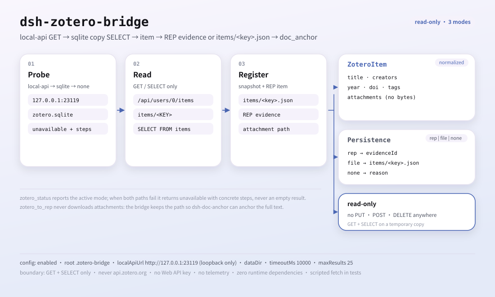
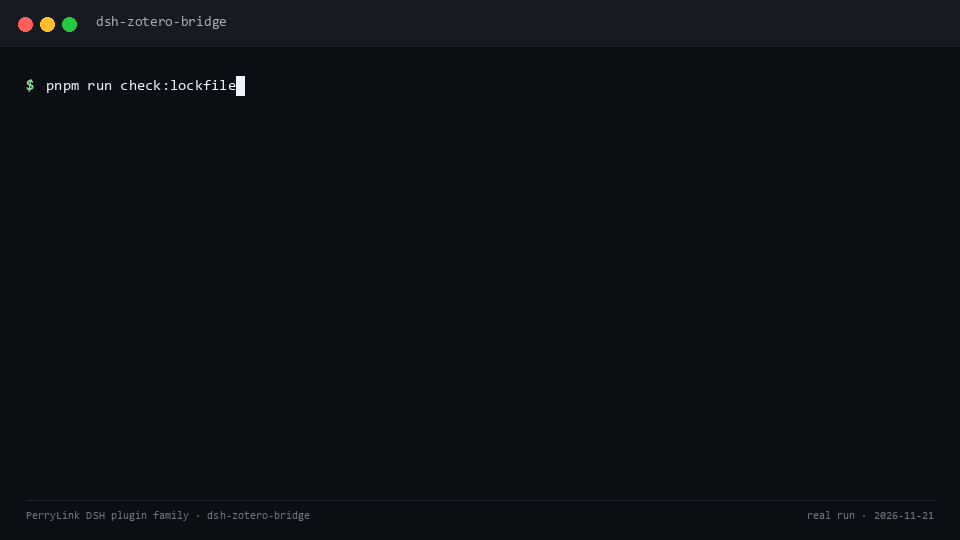

<div align="center">

<picture>
  <source media="(prefers-color-scheme: dark)" srcset="docs/assets/dsh-zotero-bridge-hero-en-dark.webp">
  
</picture>

# dsh-zotero-bridge

**Read a local Zotero library — and register the item as evidence. Never write to it.**

*Local API first, a temporary copy of `zotero.sqlite` second, and one REP evidence item per selected paper. No sync, no write, no cloud, no PDF download.*

Host compatibility: DeepSeek Harness `dsh-v0.2.2-rc.4` (verified 2026-11-18).

Last verified on DeepSeek Harness `dsh-v0.2.3-alpha.1` (2026-11-22).

[简体中文](README-zh.md) · [Español](README-es.md) · [Português](README-pt.md) · [हिन्दी](README-hi.md)

[](LICENSE)
[]()
[](https://github.com/topics/dsh-plugin)

</div>

---

## Why read-only

Your Zotero library is the only copy of years of work. One bad write can
corrupt `zotero.sqlite` or desynchronize the desktop client. This plugin
therefore has **no write path at all**: it only performs `GET` against the
Local API and `SELECT` against a temporary copy of the database.

<picture>
  <source media="(prefers-color-scheme: dark)" srcset="docs/assets/dsh-zotero-bridge-flow-v5-dark.svg">
  .json without downloading attachments; the labels inside the diagram are the real tool, endpoint and field names">
</picture>

*Structure: probe → read → register; a normalized `ZoteroItem` and its persistence (`rep` / `file` / `none`) are the two outputs, and there is no third path in which the library gets written. The token labels inside the diagram are the real tool, endpoint and field names, so the same picture serves all five languages.*

## Modes

| Mode | When | What happens |
|---|---|---|
| `local-api` | Zotero is running with **Settings → Advanced → “Allow other applications on this computer to communicate with Zotero”** | Reads `http://127.0.0.1:23119/api/users/0/...` (loopback only) |
| `sqlite` | Local API is down and `zotero.sqlite` exists | Copies the database to a temp directory, opens the copy read-only, extracts items, deletes the copy |
| `unavailable` | Neither | Returns concrete steps instead of an empty result |

## Tools

| Tool | Job |
|---|---|
| `zotero_status` | Probe the API, find the database, report the active mode and read-only policy |
| `zotero_search` | Query the library; returns title, creators, year, DOI, abstract, tags, collections, attachment metadata |
| `zotero_item` | Read one item by key, including its attachment children |
| `zotero_to_rep` | Capture the item as an immutable JSON snapshot + REP evidence (or `<root>/items/<key>.json`) |

`zotero_to_rep` does **not** download PDFs. When you need page-level anchors,
run `doc_anchor` on the attachment path — the bridge keeps the path in the
metadata so the two plugins can meet.

## Install

```sh
dsh plugin --profile <name> add dsh-zotero-bridge
dsh --profile <name> --dump-config | grep dsh-zotero-bridge
```

Then:

```text
Run zotero_status.
```

If it reports `unavailable`, start Zotero and enable the Local API, or set
`dataDir` to the directory that holds `zotero.sqlite`.

## Configuration

| Key | Default | Meaning |
|---|---|---|
| `enabled` | `true` | `false` mounts nothing |
| `root` | `.zotero-bridge` | item-record fallback root |
| `localApiUrl` | `http://127.0.0.1:23119` | loopback only; any other host fails validation |
| `dataDir` | auto-detect | Zotero data directory (or the `zotero.sqlite` file) |
| `timeoutMs` | `10000` | per-request deadline |
| `maxResults` | `25` | search cap (1–100) |

## What it does not do

- **No writes.** No create/update/delete, no notes, no tags, no collections, no trash.
- **No sync.** It never talks to `api.zotero.org`.
- **No PDF download or parsing.** Attachment metadata only; use `dsh-doc-anchor` for text.
- **No Web API keys.** The Local API needs no account or key.
- **No silent fallback.** If both modes fail, the tool reports `unavailable` with steps.

## Compatibility

| | |
|---|---|
| Zotero | 7+ (Local API opt-in); sqlite fallback reads Zotero 6/7 schema |
| Node | `^22.19.0 \|\| >=24.9.0` (sqlite uses `node:sqlite`) |
| DeepSeek Harness | peer line `dsh-v0.2.2-rc.4`（2026-11-18）；`>=0.2.1-0 <0.3.0 \|\| >=0.2.2-0 <0.3.0` |
| Peers | `@perrylink/dsh-research-core ^0.1.0`, `@deepseek-ai/cordis`, `@deepseek-ai/dsh-tools`, `@deepseek-ai/schemastery` |
| Runtime dependencies | **zero** |

## Development



*Animated: the real `pnpm run check:lockfile`, `pnpm test` and `pnpm verify:package` output on 2026-11-21 (5 test files, 16 tests, scripted fetch + a temporary sqlite copy — no Zotero, no network). The plugin has no CLI, so its documented gates are the run: the lockfile keeps its two-document form, the four tools and the sqlite fallback are exercised, and the package surface is verified read-only.*

```sh
pnpm install
pnpm run check:lockfile
pnpm typecheck
pnpm test          # fixture DB + mock Local API; no Zotero required
pnpm build
pnpm verify:package
```

The lockfile is committed exactly as `pnpm install --lockfile-only` writes it (two documents: pnpm's own package-manager document, then the project document), so a local install does not rewrite it. `pnpm run check:lockfile` fails when the lockfile drifts from `package.json` or loses that form.

The sqlite test creates a minimal Zotero-shaped database in a temp directory;
the Local API test uses a scripted fetch. Real-library acceptance is manual:
run `zotero_status` on a machine with Zotero.

## License

Apache-2.0. See [LICENSE](LICENSE).
